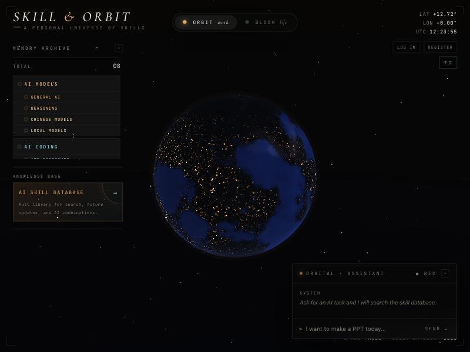
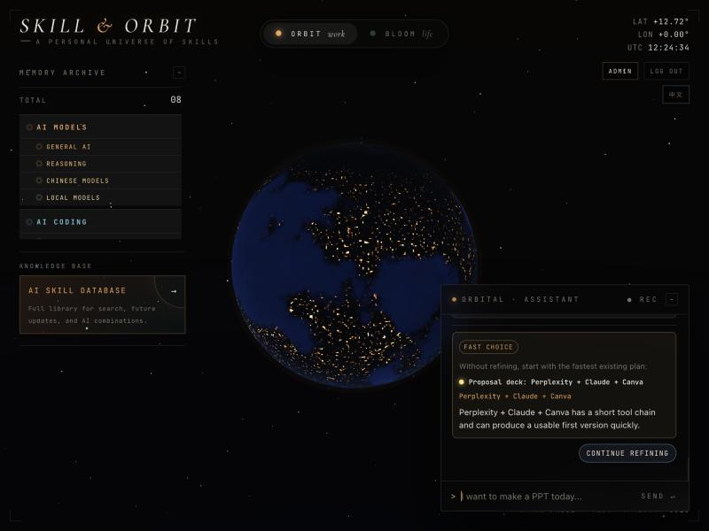

# Skill Orbit

**A 3D "orbit" for organising AI tool skills, with an AI assistant that turns a plain-language task into a ranked set of tool combinations and workflows.**

Type something like *"I want a client-facing PPT, I have materials, make it formal"* and the assistant retrieves matching skills and workflow stacks from a curated AI-tool database, then returns three plans with the reason, trade-offs, execution steps and required inputs. Vague requests get 1–3 clarifying questions first.

[中文说明 ↓](#中文说明)

| 3D orbit view | AI assistant recommendation |
|---|---|
|  |  |

## Features

- **3D orbit UI** – skills are stars on category rings (Work "Orbit" mode and Life "Bloom" mode), bilingual EN / 中文.
- **AI skill database** – 117 individual AI skills and 584 multi-tool combinations / workflows (701 indexed records), grouped by category and sub-skill taxonomy.
- **Recommendation assistant** – natural-language request → intent detection → vector retrieval → re-ranking → three plans (e.g. fastest path, best visual result, business-ready).
- **Clarification flow** – for vague requests the backend asks option-style questions (audience, existing material, priority) and folds the answers back into the ranking.
- **Feedback loop** – thumbs up/down and "too slow / want better" signals gently re-rank future results.
- **No API key needed** – runs with a local hash embedding index; OpenAI embeddings are optional.

## How the recommendation works

1. **Intent layer** – detects task intents (presentation, research report, coding, visual design, video/audio, automation/agent, business growth, data analysis) so that "PPT", "演示文档" and "汇报" map to the same workflow stack.
2. **Retrieval** – every skill/workflow is indexed with a generated intent profile and a 384-dimension local embedding; cosine similarity selects candidates.
3. **Re-ranking** – combines vector similarity, intent overlap, title/category match, workflow preference and importance, plus a small feedback adjustment.
4. **Advice** – `/api/v1/ai-skills/advice` either returns clarification questions or three recommendation plans.

More detail: [`docs/retrieval-design.md`](docs/retrieval-design.md) and [`docs/ai-skill-combination-backend-design.md`](docs/ai-skill-combination-backend-design.md).

## Tech stack

| Layer | Tools |
|---|---|
| Frontend | Static HTML + vanilla JS (`orbit.js`), WebGL 3D globe |
| Backend | Python, FastAPI, SQLAlchemy, Alembic |
| Storage | SQLite |
| Retrieval | Local hash embeddings (384-dim, cosine) · optional OpenAI `text-embedding-3-small` |
| Quality | pytest, GitHub Actions CI |
| Packaging | Docker / docker compose |

## Quick start

**Requirements:** Python 3.11+ and a modern browser. Docker is optional.

### Option A – one click (macOS)

```bash
./"Start Skill Orbit.command"
```

This creates the backend virtualenv, installs dependencies, applies the database migrations, starts the API and a static file server, and opens the app in your browser.

### Option B – two terminals (macOS / Linux)

```bash
# terminal 1 – backend API (http://127.0.0.1:8000, docs at /docs)
./start_backend.sh

# terminal 2 – static frontend (http://127.0.0.1:5173)
./start_frontend.sh
```

Then open <http://127.0.0.1:5173/Skill%20Memory%20Globe.html>.

### Option C – Docker (backend only)

```bash
cp .env.example .env
docker compose up --build        # API on http://localhost:8000
./start_frontend.sh               # serve the frontend separately
```

### Using the assistant

The assistant needs a signed-in user. Use **Register** in the top-right corner, or sign in with the local development admin account defined in `.env.example` (`DEFAULT_ADMIN_*`). **Change these values in your own `.env` before using the project beyond local development.**

### Optional: OpenAI embeddings

```bash
# in .env
EMBEDDING_PROVIDER=openai
OPENAI_API_KEY=<your key>
```

## Tests

```bash
cd backend
python3 -m venv .venv && source .venv/bin/activate
pip install -r requirements-dev.txt
alembic upgrade head
pytest -q
```

The suite covers the API health check, retrieval and recommendation endpoints, the clarification flow, feedback storage, and recommendation-quality checks across the eight major intents (including option-combination matrices that should produce different rankings). It also runs in CI on every push and pull request.

## API overview

| Endpoint | Purpose |
|---|---|
| `GET /api/v1/health` | Service readiness |
| `POST /api/v1/auth/register` · `/login` · `GET /me` | Accounts |
| `GET /api/v1/ai-skills/search` | Semantic search over skills / workflows |
| `POST /api/v1/ai-skills/compose` | Low-level retrieval |
| `POST /api/v1/ai-skills/recommend` | Ranked recommendation plans |
| `POST /api/v1/ai-skills/advice` | Clarification questions or plans (used by the chat UI) |
| `POST /api/v1/ai-skills/feedback` | Store recommendation feedback |

Interactive docs: <http://127.0.0.1:8000/docs>

## Project structure

```
backend/
  app/
    api/routes/      FastAPI routes (ai_skills, auth, chat, skills, health)
    services/        embeddings, semantic intents, classifier
    repositories/    database access (skills, AI library, embeddings, users)
    db/              models, session, seed data and sub-skill taxonomy
    models/          SQLAlchemy models
  migrations/        Alembic versions (0001 – 0007)
  tests/             pytest suite
docs/                design notes (retrieval, backend design, workflow)
orbit.js             frontend logic (3D orbit, assistant, auth)
Skill Memory Globe.html   main frontend entry point
```

## Team

Built as a two-person project. See the commit history for details; the work was split roughly as follows:

- **Jasmine Zhang** – GitHub collaboration workflow and CI, AI skill database and bilingual orbit modes, workflow seeds and unified stack view, retrieval layer, recommendation guidance and feedback, quality tests.
- **Zhance Xu** – sub-skill taxonomy, curated AI library and tool database expansion, landing-view visual design.

## Contributing

Branch workflow is described in [`docs/github-collaboration.md`](docs/github-collaboration.md): feature branches → `develop` → reviewed pull requests into `main`.

---

## 中文说明

**Skill Orbit 是一个用 3D 星轨来整理 AI 工具技能的网站,并配有 AI 助手:输入一句话需求,系统从 AI 技能库里检索并推荐可执行的工具组合与工作流。**

### 功能

- **3D 星轨界面**:技能是分类轨道上的星点,支持"工作 Orbit / 生活 Bloom"两种模式和中英文切换。
- **AI 技能库**:117 条 AI 技能和 584 条多工具组合/工作流(共 701 条向量索引记录),按分类和子技能体系整理。
- **推荐助手**:自然语言需求 → 意图识别 → 向量检索 → 重排序 → 给出 3 个方案(含原因、取舍、执行步骤、所需输入)。
- **追问机制**:需求模糊时先给出 1–3 个选项式问题(受众、已有资料、优先级),再把答案并入排序。
- **反馈机制**:用户反馈会小幅调整后续排序。
- **无需 API Key**:默认使用本地哈希向量索引,可选接入 OpenAI embedding。

### 快速运行

要求:Python 3.11+、现代浏览器(Docker 可选)。

```bash
# 方式一:macOS 一键启动
./"Start Skill Orbit.command"

# 方式二:两个终端
./start_backend.sh      # 后端 http://127.0.0.1:8000 ,接口文档 /docs
./start_frontend.sh     # 前端 http://127.0.0.1:5173
```

浏览器打开 <http://127.0.0.1:5173/Skill%20Memory%20Globe.html>。

使用 AI 助手需要先登录:点右上角 **Register** 注册,或使用 `.env.example` 中 `DEFAULT_ADMIN_*` 定义的本地开发账号。正式使用前请在自己的 `.env` 里修改。

### 运行测试

```bash
cd backend
python3 -m venv .venv && source .venv/bin/activate
pip install -r requirements-dev.txt
alembic upgrade head
pytest -q
```

### 推荐原理(简述)

意图识别层(8 类主要意图,如"PPT / 演示文档 / 汇报"归到同一类)→ 本地 384 维向量检索 → 结合向量相似度、意图重叠、标题匹配、工作流偏好和反馈做重排序 → 返回 3 个方案或追问问题。详见 `docs/retrieval-design.md`。
